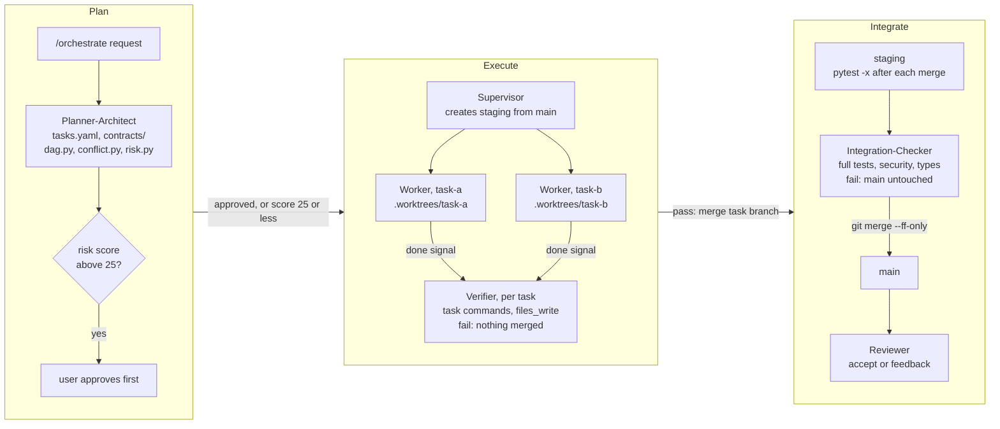

# Claude Code Multi-Agent Orchestration

Coordinates several Claude Code agents working on one repository at the same time. A planner agent splits a request into tasks that declare the files they own and the tasks they depend on. The design runs each task in its own git worktree against interface contracts fixed before the work starts, verifies each finished task before merging it into a staging branch, and checks the integrated result before it reaches `main`. The aim is that parallel changes merge without collisions.

This is a prototype made of Claude Code agent definitions, one skill and standalone Python scripts. It is not packaged, and the scripts have no automated tests. [Status](#status) separates what the scripts implement, what exists only in the agent definitions, and what is design only.

## The problem

Agents working in parallel on one codebase tend to fail in three ways:

- Two agents edit the same file on separate branches, and nobody owns the resulting conflict.
- One agent codes against an interface that another agent is still deciding, so each side passes its own tests and the two fail together.
- An agent reports that its work is done, and the report is accepted without evidence.

Each has a counterpart here: exclusive file ownership with dependency ordering, version-stamped interface contracts, and a verifier that is not the agent that did the work.

## How it works



The Execute and Integrate stages follow `supervisor.md`. The planner-architect runs as a subagent of the `orchestrate` skill and is the only agent that receives its definition. Every later agent is a separate `claude -p` process in its own tmux session, started by `tmux.py` with a prompt file and no `--agent`. The supervisor gets the planner's seven-line prompt, which refers it to "system instructions" it does not have. The prompts for workers, verifiers, the integration checker and the reviewer are short templates that exist only in `supervisor.md` (Stages 2, 3, 5 and 7). Stages hand over through signal files in `.orchestrator/signals/`: `<task-id>.done`, `<task-id>.verified`, `<task-id>.failed`, `integration.passed`, `integration.failed`, `review.done` and `orchestration.done`.

## Status

| Part | At HEAD | Notes |
|------|---------|-------|
| Plan validation: unknown dependencies, cycles, execution waves | Implemented | `dag.py` |
| Collision detection on files and resources | Implemented, with a gap | `conflict.py`; see [Limitations](#limitations) |
| Risk score and approval threshold | Implemented | `risk.py` |
| Contract stub generation, stamped with the git hash | Implemented | `contracts.py` |
| Contract version comparison | Not implemented | The version is recorded, never compared |
| Boundary check, verification commands, environment hash | Implemented | `verify.py`, `environment.py`; see [Limitations](#limitations) |
| Task state machine, resume, atomic state file | Implemented | `state.py`; the definitions call only its staging lock |
| Agent spawning, signal files, timeouts, pre-flight check | Implemented | `tmux.py` |
| Agent definitions applied to the tmux sessions | Not implemented | `tmux.py` passes no `--agent`, so only the planner gets its definition |
| Worker mailbox, shared context store | Implemented | `mailbox.py`, `context.py` |
| Git worktree and git helpers | Implemented, not called by any agent definition | `worktree.py`, `git.py` |
| Terminal dashboard, worker view, monitoring windows | Implemented, started by hand | `dashboard.py`, `workers_view.py`, `monitoring.py` |
| Stage order, merge to staging, fast-forward to `main`, review loop, escalation | In the definitions only; no tmux session receives them | `.claude/agents/*.md` |
| Structured patch intents, framework adapters, region markers | Design only | `ARCHITECTURE_8.md`; an earlier implementation was removed in `f7df662` |
| Churn and format-only checks, `files_append`, `{modified_tests}` | Design only | `ARCHITECTURE_8.md` |
| `.claude-agents.yaml` sections other than `risk:` | Design only | `ARCHITECTURE_8.md` |

`pytest tests/e2e_demo` passes (44 tests), but it covers only the three demo modules in that directory. `tests/unit` and `tests/integration` import a package that was removed and fail at collection. The git history holds one recorded exercise of the pipeline, a three-module calculator demo; see [Limitations](#limitations).

## Design decisions

These are recorded in the commit messages.

- **Remove tools instead of discouraging them.** With both the Task tool and tmux available, the supervisor "chose the easy path, bypassing worktrees and signal files", so the Task tool was removed from its tool list (`1339d9f`). The removal lapsed when the supervisor moved into tmux (`14f36c4`), because `tmux.py` does not apply a definition's tool list.
- **The agent that verifies also merges.** This leaves no gap between "verified" and "merged" and gives the merge decision to the agent that holds the evidence (`b60af90`).
- **A staging branch between tasks and `main`.** `main` moves only by fast-forward after the integration check, so a failed integration check leaves it untouched (`cdbeedb`).
- **Headless sessions with permissions bypassed.** A supervisor nested inside the planner triggered a permission prompt for every Bash command, so it was moved into its own tmux session with permissions bypassed, like the workers (`14f36c4`). The plan and the after-the-fact checks are then the only controls.

## Mechanisms

This section describes what the scripts do and what the agent definitions say. Only the planner receives its definition, so the parts taken from `supervisor.md`, `worker.md`, `verifier.md` and `integration-checker.md` describe the design, not what the tmux sessions are told.

### Tasks and dependencies

The planner writes `tasks.yaml`. Each task lists the files it writes and reads, the logical resources it claims (for example `di:CsvWriter` or `route:/export`), the tasks it depends on, and at least one verification command:

```yaml
tasks:
  - id: task-csv-writer
    files_write: ["src/export/csv_writer.py", "tests/test_csv_writer.py"]
    files_read: ["src/models/record.py"]
    resources_write: ["di:CsvWriter"]
    depends_on: []
    verification:
      - command: "pytest tests/test_csv_writer.py"
        type: test
        required: true

  - id: task-export-command
    files_write: ["src/cli.py", "tests/test_cli_export.py"]
    depends_on: [task-csv-writer]
    verification:
      - command: "pytest tests/test_cli_export.py"
        type: test
        required: true

contracts:
  - name: "CsvWriterProtocol"
    version: "abc1234"
    file_path: "contracts/csv_writer_interface.py"
```

The complete example is [`docs/example-tasks.yaml`](docs/example-tasks.yaml). Before any agent starts:

- `dag.py` rejects unknown dependency IDs and cycles, and prints the execution waves.
- `conflict.py` groups the tasks that write each path, the tasks that read a path another task writes, and the tasks that claim each resource. It reports a group when no two of its tasks are linked by a chain of `depends_on`, and suggests making the second task depend on the first. Paths are compared as exact strings.
- `risk.py` scores the plan. Above 25 the planner definition says to ask the user before starting the supervisor.

A task with no verification command is invalid. `planner-architect.md` forbids it, `state.py init` rejects it and `verify.py` refuses to run it.

### Isolation with git worktrees

For each task, `supervisor.md` says to run `git worktree add -b task/<id> .worktrees/<id> main` and to start that task's worker inside the new directory, as a separate Claude Code process in its own tmux session. It also says to run at most five workers at once, started 15 seconds apart; `tmux.py` enforces neither. A worker has its own checkout and branch, so it cannot edit another task's working files by accident.

The isolation is by working directory, not by sandbox. Workers run with permissions bypassed, so ownership can only be checked afterwards, by comparing what changed with `files_write` (`verify.py boundaries`).

### Interface contracts

A contract is a `typing.Protocol` stub in `contracts/` that tasks agree on before any of them starts. Its header records a version: the short git hash of the repository when the contract was generated. This is `contracts/calculator_protocol.py`, one of the two demo contracts:

```python
"""
CalculatorProtocol - Interface contract for calculator module
Version: 804534f
"""
from typing import Protocol


class CalculatorProtocol(Protocol):
    """Protocol defining the calculator interface."""

    def add(self, a: float, b: float) -> float:
        """Add two numbers and return the result."""
        ...

    # subtract() omitted here
```

The demo modules `tests/e2e_demo/calculator.py` and `formatter.py` carry the same version in their docstrings.

`worker.md` tells workers to read the contract instead of guessing a signature, and to record the contract name, version and methods they used in `.task-status.json`. `verifier.md` tells the verifier to run `mypy --strict` (or pyright, or `tsc`) on any task that uses a contract; a signature mismatch is a `contract_mismatch` failure and blocks the merge. `planner-architect.md` allows two renegotiations of a contract and sends a third to the user.

The version is recorded, not enforced by code. No script compares the version a worker recorded with the contract on disk, and the worker and verifier sessions do not receive `worker.md` or `verifier.md`.

### Verification and merging

Each completed task is meant to get its own verifier, a separate session from the worker. `verifier.md` has it:

1. run the task's verification commands in the worktree (`verify.py commands`): in order, stopping at the first required failure, with a 300 second default timeout per command;
2. check that every file changed in the task's last commit is listed in `files_write` and matches none of the forbidden patterns `node_modules/`, `__pycache__/`, `*.pyc`, `.git/`, `.env` and `*.lock` (`verify.py boundaries`);
3. compare the environment hash, a hash of the project's lockfiles, with the value recorded at the start (`environment.py --verify`);
4. type-check any contract the task used;
5. if everything passes, merge `task/<id>` into `staging` and write `<task-id>.verified`; otherwise merge nothing and write `<task-id>.failed`.

The verifier prompt in `supervisor.md` (Stage 3) asks only for the task's commands, a check that only `files_write` changed, the merge or no merge, and the signal. `supervisor.md` then has the supervisor run `pytest -x` on `staging` after every merge, so a broken build is attributed to the task merged last. When all tasks are verified, it starts an integration checker that runs the full test suite, a security scan and a type check on `staging`, and moves `main` forward with `git merge --ff-only`. In `integration-checker.md` only a failing test suite or a high-severity security finding blocks promotion; type and lint results are reported. If a check fails, or `main` has moved so that a fast-forward is impossible, `main` is left untouched.

Stage 7 of `supervisor.md` then starts a reviewer whose prompt asks it to review the work, check that the request is met, write `review.done` and report ACCEPT or feedback. The three-iteration limit, the escalation report and the user's choice between fixing by hand and resuming, re-planning, or aborting are in `planner-architect.md`, which that session does not receive.

## Try it

### Planning scripts (no agents, no API calls)

These need Python 3.10 or later and PyYAML. [`docs/example-tasks.yaml`](docs/example-tasks.yaml) has three tasks, two of which write `src/cli.py` with no dependency between them.

```console
$ git clone https://github.com/SynBioExplorer/Claude_Code_agentic_coding.git
$ cd Claude_Code_agentic_coding
$ python3 .claude/orchestrator_code/dag.py docs/example-tasks.yaml
Execution waves (2 waves):
  Wave 1: task-csv-writer, task-since-filter
  Wave 2: task-export-command

$ python3 .claude/orchestrator_code/conflict.py docs/example-tasks.yaml
  [FILE_WRITE_WRITE] src/cli.py
    Tasks: task-export-command, task-since-filter
    Fix: Add dependency: task-since-filter depends_on [task-export-command]

$ python3 .claude/orchestrator_code/risk.py docs/example-tasks.yaml
Risk Score: 0 (AUTO-APPROVE)
Auto-approve threshold: 25
Factors:
```

The output is abridged: blank lines and the status lines that begin with a tick or a warning symbol are left out, and the order of tasks within a wave can vary between runs. `conflict.py` exits with status 1 when it finds a conflict. Adding the suggested `depends_on` clears it and turns the plan into three waves. No path matches a sensitive pattern and every task has a test, so the score is 0 and the plan needs no approval; a path containing `auth`, for example, would add 20.

### Full pipeline

Requirements: the Claude Code CLI (`claude` on the PATH), git in a repository whose default branch is `main`, tmux, Python 3.10 or later with PyYAML, and optionally `rich` for the dashboard. macOS or Linux; the monitoring windows that `state.py init` opens are macOS only.

```bash
mkdir -p ~/.claude/agents ~/.claude/skills
cp .claude/agents/*.md ~/.claude/agents/   # overwrites agents of the same name
cp -r .claude/orchestrator_code ~/.claude/
cp -r .claude/skills/orchestrate ~/.claude/skills/
python3 ~/.claude/orchestrator_code/tmux.py preflight
```

The agent definitions call `python3 ~/.claude/orchestrator_code/...`, so the scripts must be installed there. `pyproject.toml` points at `src/claude_orchestrator`, which no longer exists, so the repository is not an installable package.

Then, in a Claude Code session inside the target repository:

```
/orchestrate Add a CSV export command with a --since filter
```

The planner writes `tasks.yaml` and `contracts/` and reports the risk score. A plan scoring 25 or less starts without asking. Above 25, `planner-architect.md` asks for approval, but `SKILL.md` expects the planner to return with the supervisor already running and has no approval step, so start with a low-risk request such as this one (its example plan scores 0). The supervisor, workers, verifiers, integration checker and reviewer then run as separate `claude -p` processes with `--dangerously-skip-permissions`. Try it first on a disposable repository: a run starts several sessions and uses tokens accordingly. Stage 0 of `supervisor.md` also sets a cleanup trap that calls `tmux kill-server`, which would end every session on the default tmux server, not only the orchestrator's.

Operational notes, script options and troubleshooting are in [`docs/reference.md`](docs/reference.md).

## Agents

| Agent | Declared model | Started by | Role |
|-------|----------------|------------|------|
| `planner-architect` | opus | the `orchestrate` skill, as a subagent | Splits the request into tasks, writes contracts, gates on risk and starts the supervisor |
| `supervisor` | sonnet | the planner, in tmux | Creates `staging` and the worktrees, starts and watches the other agents, runs the incremental test, starts the reviewer, cleans up |
| `worker` | sonnet | the supervisor, in tmux | Implements one task in its worktree |
| `verifier` | haiku | the supervisor, in tmux | Checks one task and merges it to `staging` if it passes |
| `integration-checker` | sonnet | the supervisor, in tmux | Runs the full checks on `staging` and fast-forwards `main` |

The model is the `model:` line of each definition in `.claude/agents/`, and the roles are those the definitions describe. `tmux.py` starts each tmux agent as `claude --dangerously-skip-permissions --permission-mode bypassPermissions -p` with the prompt on standard input and passes neither `--agent` nor `--model`. A tmux session therefore runs with the default model and tool list and knows its role only from its prompt. The reviewer has no definition of its own: its prompt calls it the planner-architect in review mode.

The definitions also carry rules aimed at the agents' own shortcuts: a test-first rule and a verification gate for workers, an output-reading rule for the verifier and integration checker (exit code 0 with "0 tests collected" is not a pass), tables of common rationalisations with rebuttals, and a three-strike limit on debugging. They are inspired by the [Superpowers](https://github.com/obra/superpowers) skills by Jesse Vincent. Like the rest of those definitions, these rules do not reach the tmux sessions.

## Limitations

- **Evidence.** The history holds one recorded run: the calculator demo of 2026-01-29 (merge commits `0d8bac2`, `25f3a46`, `bb4d306`). It predates the staging branch, the tmux-started supervisor, the mailbox and `f7df662`, which removed `--agent worker` from the spawn command in `supervisor.md`. Later commit messages record problems seen while the pipeline was run: the supervisor bypassing worktrees while it had the Task tool (`1339d9f`), false-positive process checks and permission prompts from compound Bash commands (`2d9b3d7`), and a permission prompt for every Bash command in the nested supervisor (`14f36c4`). The repository keeps no logs, plans or transcripts of those runs.
- **Tests.** Only `tests/e2e_demo` runs. `tests/unit` and `tests/integration` import `claude_orchestrator`, a package removed in `f7df662`. The scripts in `.claude/orchestrator_code/` have no tests.
- **Contracts.** Versions are recorded, not compared (see above).
- **Collision check.** `conflict.py` treats a group of tasks as ordered when any two of them are linked by `depends_on`. With three tasks writing one file and only two of them ordered, it reports nothing, and `dag.py` can put the third in the same wave as one of the others.
- **Ownership check.** `verify.py boundaries` compares exact `files_write` strings with the files changed in the last commit of the task branch (`HEAD~1..HEAD`). Changes in earlier commits are not examined, and paths written as globs do not match. The churn and format-only checks in the specification are not implemented.
- **Dependent tasks and plan files.** Worktrees are created from `main` (`supervisor.md`, Stage 1), while verified work is merged into `staging`. The definitions do not say how a task in a later wave receives the code of the tasks it depends on; the intended channel is the contract. But the planner writes `tasks.yaml` and `contracts/` to the working tree and no definition commits them, so a worktree created from `main` does not contain them unless they were committed first.
- **Review timing.** `supervisor.md` removes each worktree after its incremental check (Stage 4), deletes `staging` after promotion (Stage 6) and only then starts the review (Stage 7). A rejected review therefore finds `main` already moved, and `staging` and the worktrees, which the escalation protocol says to keep, already gone.
- **Concurrency.** The staging lock in `verifier.md` and `supervisor.md` is taken in a short `python3 -c` process, which releases it on exit, before the `git merge` it was meant to protect. `mailbox.py` finds `.orchestrator/mailbox` from the current directory and its command line has no project-directory option, while workers run inside `.worktrees/<id>`; unless a worker changes directory first, sender and recipient do not share a mailbox.
- **Environment hash.** It is a hash of lockfiles and is the constant `no-lock` when the project has none, so the check cannot fail there.
- **Language.** `contracts.py` emits Python `Protocol` stubs, and the per-merge check in `supervisor.md` is `pytest tests/ -x`; other ecosystems need those two places changed.
- **Wiring and platform.** No agent definition runs `state.py init`, `monitoring.py` or `dashboard.py`, so the state file, the dashboard and the monitoring windows exist only if started by hand, although `SKILL.md` describes them as automatic. Monitoring windows use AppleScript (macOS only). Locking uses `fcntl` and risk scoring uses `SIGALRM`, so the scripts need a POSIX system.

## Repository layout

```
.claude/agents/              five agent definitions
.claude/skills/orchestrate/  the /orchestrate skill
.claude/orchestrator_code/   standalone Python scripts called by the agents
contracts/                   the two demo interface contracts
tests/e2e_demo/              demo modules built in the recorded run, with tests
tests/unit/, tests/integration/   tests for a removed package; they do not run
templates/                   Jinja2 templates; nothing at HEAD references them
docs/                        reference notes and the example plan
ARCHITECTURE_8.md            design specification; parts are not implemented
architecture.svg             overview figure of the same flow
CLAUDE.md                    guidance for Claude Code sessions in this repository
pyproject.toml               describes the removed package; not installable
```

## Further reading

- [`docs/reference.md`](docs/reference.md): scripts and options, task fields, risk scoring, monitoring, mailbox, dependency requests, resuming, troubleshooting.
- [`ARCHITECTURE_8.md`](ARCHITECTURE_8.md): the design specification, including the parts that are not implemented.
- [`architecture.svg`](architecture.svg): an overview figure of the same flow.

## Licence

MIT.
