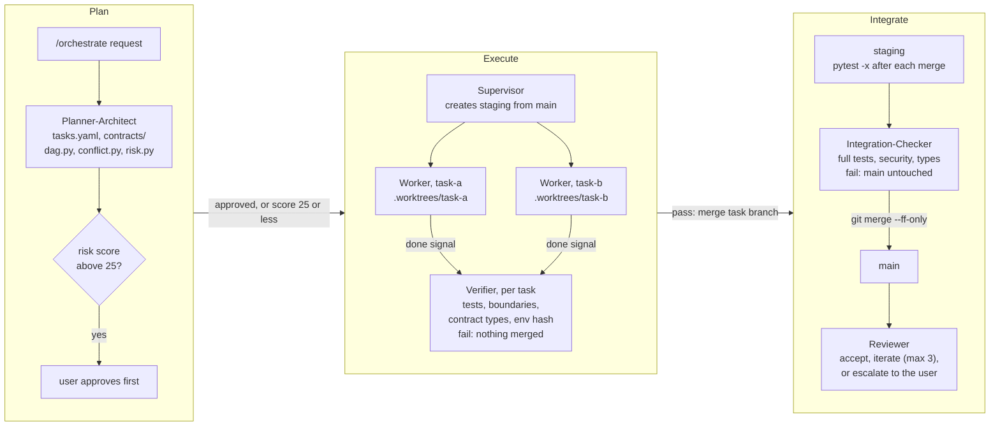

# Claude Code Multi-Agent Orchestration

Coordinates several Claude Code agents working on one repository at the same time. A planner agent splits a request into tasks that declare the files they own and the tasks they depend on. Each task runs in its own git worktree against interface contracts fixed before the work starts. Each finished task is verified before it is merged into a staging branch, and the integrated result is checked before it reaches `main`. The aim is that parallel changes merge without collisions.

This is a prototype made of Claude Code agent definitions, one skill and standalone Python scripts. It is not packaged, and the scripts have no automated tests. [Status](#status) separates what is implemented from what is only instructions to the agents and what is design only.

## The problem

Agents working in parallel on one codebase tend to fail in three ways:

- Two agents edit the same file on separate branches, and nobody owns the resulting conflict.
- One agent codes against an interface that another agent is still deciding, so each side passes its own tests and the two fail together.
- An agent reports that its work is done, and the report is accepted without evidence.

Each has a counterpart here: exclusive file ownership with dependency ordering, version-stamped interface contracts, and a verifier that is not the agent that did the work.

## How it works



The planner-architect runs as a subagent of the `orchestrate` skill. Every later agent is a separate `claude -p` process in its own tmux session, started by `tmux.py`. Stages hand over through signal files in `.orchestrator/signals/`: `<task-id>.done`, `<task-id>.verified`, `<task-id>.failed`, `integration.passed`, `integration.failed` and `orchestration.done`.

## Status

| Part | At HEAD | Notes |
|------|---------|-------|
| Plan validation: unknown dependencies, cycles, execution waves | Implemented | `dag.py` |
| Collision detection on files and resources | Implemented | `conflict.py` |
| Risk score and approval threshold | Implemented | `risk.py` |
| Contract stub generation, stamped with the git hash | Implemented | `contracts.py` |
| Contract version comparison | Not implemented | The version is recorded, never compared |
| Boundary check, verification commands, environment hash | Implemented | `verify.py`, `environment.py`; see [Limitations](#limitations) |
| Task state machine, resume, atomic state file | Implemented | `state.py`; the agents call only its staging lock |
| Agent spawning, signal files, timeouts, pre-flight check | Implemented | `tmux.py` |
| Worker mailbox, shared context store | Implemented | `mailbox.py`, `context.py` |
| Git worktree and git helpers | Implemented, not called by any agent definition | `worktree.py`, `git.py` |
| Terminal dashboard, worker view, monitoring windows | Implemented, started by hand | `dashboard.py`, `workers_view.py`, `monitoring.py` |
| Stage order, merge to staging, fast-forward to `main`, review loop, escalation | Instructions to the agents, not code | `.claude/agents/*.md` |
| Structured patch intents, framework adapters, region markers | Design only | `ARCHITECTURE_8.md`; an earlier implementation was removed in `f7df662` |
| Churn and format-only checks, `files_append`, `{modified_tests}` | Design only | `ARCHITECTURE_8.md` |
| `.claude-agents.yaml` sections other than `risk:` | Design only | `ARCHITECTURE_8.md` |

`pytest tests/e2e_demo` passes (44 tests), but it covers only the three demo modules in that directory. `tests/unit` and `tests/integration` import a package that was removed and fail at collection. The git history holds one recorded exercise of the pipeline, a three-module calculator demo; see [Limitations](#limitations).

## Mechanisms

This section describes what the scripts do and what the agent definitions instruct. The [Status](#status) table says which is which.

### Tasks and dependencies

The planner writes `tasks.yaml`. Each task lists the files it writes and reads, the logical resources it claims (for example `route:/auth` or `di:AuthService`), the tasks it depends on, and at least one verification command:

```yaml
tasks:
  - id: task-auth-service
    files_write: ["src/services/auth.py", "tests/test_auth.py"]
    files_read: ["src/models/user.py"]
    resources_write: ["di:AuthService"]
    depends_on: []
    verification:
      - command: "pytest tests/test_auth.py"
        type: test
        required: true

  - id: task-auth-routes
    files_write: ["src/routes/auth.py"]
    depends_on: [task-auth-service]
    verification:
      - command: "pytest tests/test_auth_routes.py"
        type: test
        required: true

contracts:
  - name: "AuthServiceProtocol"
    version: "abc1234"
    file_path: "contracts/auth_interface.py"
```

The complete example is [`docs/example-tasks.yaml`](docs/example-tasks.yaml). Before any agent starts:

- `dag.py` rejects unknown dependency IDs and cycles, and prints the execution waves.
- `conflict.py` reports two tasks that write the same file or claim the same resource, or one task that reads a file another writes, when no dependency orders them. It suggests the `depends_on` that would. Paths are compared as exact strings.
- `risk.py` scores the plan. Above 25 the planner asks the user before the supervisor starts.

A task with no verification command is invalid. `planner-architect.md` forbids it, `state.py init` rejects it and `verify.py` refuses to run it.

### Isolation with git worktrees

For each task the supervisor runs `git worktree add -b task/<id> .worktrees/<id> main` and starts that task's worker inside the new directory, as a separate Claude Code process in its own tmux session. At most five workers run at once, started 15 seconds apart. A worker has its own checkout and branch, so it cannot edit another task's working files by accident.

The isolation is by working directory, not by sandbox. Workers run with permissions bypassed, so the ownership rule is enforced afterwards, when the verifier compares what changed with `files_write`.

### Interface contracts

A contract is a `typing.Protocol` stub in `contracts/` that tasks agree on before any of them starts. Its header records a version: the short git hash of the repository when the contract was generated. This is `contracts/calculator_protocol.py`, one of the two demo contracts:

```python
"""
CalculatorProtocol - Interface contract for calculator module
Version: 804534f
"""
from typing import Protocol


class CalculatorProtocol(Protocol):
    """Protocol defining the calculator interface."""

    def add(self, a: float, b: float) -> float:
        """Add two numbers and return the result."""
        ...

    # subtract() omitted here
```

The demo modules `tests/e2e_demo/calculator.py` and `formatter.py` carry the same version in their docstrings.

Workers are told to read the contract instead of guessing a signature, and to record the contract name, version and methods they used in `.task-status.json`. The verifier is told to run `mypy --strict` (or pyright, or `tsc`) on any task that uses a contract. A signature mismatch is a `contract_mismatch` failure and blocks the merge. A contract may be renegotiated twice; a third change goes to the user.

The version is recorded, not enforced by code. No script compares the version a worker recorded with the contract on disk. The type check and the renegotiation limit are instructions in `verifier.md` and `planner-architect.md`.

### Verification and merging

Each completed task gets its own verifier, a separate session from the worker. `verifier.md` has it:

1. run the task's verification commands in the worktree (`verify.py commands`): in order, stopping at the first required failure, with a 300 second default timeout per command;
2. check that every file changed in the task's last commit is listed in `files_write` and matches none of the forbidden patterns `node_modules/`, `__pycache__/`, `*.pyc`, `.git/`, `.env` and `*.lock` (`verify.py boundaries`);
3. compare the environment hash, a hash of the project's lockfiles, with the value recorded at the start (`environment.py --verify`);
4. type-check any contract the task used;
5. if everything passes, merge `task/<id>` into `staging` and write `<task-id>.verified`; otherwise merge nothing and write `<task-id>.failed`.

After every merge the supervisor runs `pytest -x` on `staging`, so a broken build is attributed to the task merged last. When all tasks are verified, the integration checker runs the full test suite, a security scan and a type check on `staging`, and moves `main` forward with `git merge --ff-only`. A failing test suite or a high-severity security finding blocks promotion; type and lint results are only reported. If a check fails, or `main` has moved so that a fast-forward is impossible, `main` is left untouched.

A final review by the planner-architect accepts the result or sends it back, up to three iterations. After that the run stops and writes `.orchestrator/escalation-report.md`, and the user chooses between fixing by hand and resuming, re-planning, or aborting.

## Try it

### Planning scripts (no agents, no API calls)

These need Python 3.10 or later and PyYAML. [`docs/example-tasks.yaml`](docs/example-tasks.yaml) has three tasks, two of which write `src/routes/auth.py` with no dependency between them.

```console
$ python3 .claude/orchestrator_code/dag.py docs/example-tasks.yaml
Execution waves (2 waves):
  Wave 1: task-auth-service, task-auth-refresh
  Wave 2: task-auth-routes

$ python3 .claude/orchestrator_code/conflict.py docs/example-tasks.yaml
  [FILE_WRITE_WRITE] src/routes/auth.py
    Tasks: task-auth-routes, task-auth-refresh
    Fix: Add dependency: task-auth-refresh depends_on [task-auth-routes]

$ python3 .claude/orchestrator_code/risk.py docs/example-tasks.yaml
Risk Score: 80 (HIGH RISK)
Auto-approve threshold: 25
Factors:
  - sensitive_path:src/services/auth.py:auth
  - sensitive_path:tests/test_auth.py:auth
  - sensitive_path:src/routes/auth.py:auth
  - sensitive_path:src/routes/auth.py:auth
```

The output is abridged: the status lines that begin with a tick or a warning symbol are left out, and the order of tasks within a wave can vary between runs. `conflict.py` exits with status 1 when it finds a conflict. Adding the suggested `depends_on` clears it and turns the plan into three waves. Every path containing `auth` adds 20 to the risk score, which is why this small plan needs approval.

### Full pipeline

Requirements: the Claude Code CLI (`claude` on the PATH), git in a repository whose default branch is `main`, tmux, Python 3.10 or later with PyYAML, and optionally `rich` for the dashboard. macOS or Linux; the monitoring windows that `state.py init` opens are macOS only.

```bash
git clone https://github.com/SynBioExplorer/Claude_Code_agentic_coding.git
cd Claude_Code_agentic_coding
mkdir -p ~/.claude/agents ~/.claude/skills
cp .claude/agents/*.md ~/.claude/agents/   # overwrites agents of the same name
cp -r .claude/orchestrator_code ~/.claude/
cp -r .claude/skills/orchestrate ~/.claude/skills/
python3 ~/.claude/orchestrator_code/tmux.py preflight
```

The agent definitions call `python3 ~/.claude/orchestrator_code/...`, so the scripts must be installed there. `pyproject.toml` points at `src/claude_orchestrator`, which no longer exists, so the repository is not an installable package.

Then, in a Claude Code session inside the target repository:

```
/orchestrate Add user authentication with JWT tokens and a refresh flow
```

The planner writes `tasks.yaml` and `contracts/` and reports the risk score. A plan scoring 25 or less starts without asking; a higher score waits for your approval. Workers, verifiers and the integration checker then run as separate `claude -p` processes with `--dangerously-skip-permissions`. Try it first on a disposable repository: a run starts several sessions and uses tokens accordingly. The supervisor's cleanup trap also calls `tmux kill-server` (`supervisor.md`, Stage 0), which ends every session on the default tmux server, not only the orchestrator's.

Operational notes, script options and troubleshooting are in [`docs/reference.md`](docs/reference.md).

## Agents

| Agent | Declared model | Started by | Role |
|-------|----------------|------------|------|
| `planner-architect` | opus | the `orchestrate` skill, as a subagent | Splits the request into tasks, writes contracts, gates on risk, starts the supervisor, and later reviews the result |
| `supervisor` | sonnet | the planner, in tmux | Creates `staging` and the worktrees, starts and watches the other agents, runs the incremental test, cleans up. It has no Task tool |
| `worker` | sonnet | the supervisor, in tmux | Implements one task in its worktree |
| `verifier` | haiku | the supervisor, in tmux | Checks one task and merges it to `staging` if it passes |
| `integration-checker` | sonnet | the supervisor, in tmux | Runs the full checks on `staging` and fast-forwards `main` |

The model is the `model:` line of each definition in `.claude/agents/`. `tmux.py` starts each tmux agent as `claude --dangerously-skip-permissions --permission-mode bypassPermissions -p` with the prompt on standard input. It passes neither `--agent` nor `--model`, so the role reaches the session through the prompt text, and the spawner does not select the definition's model or tool list.

Each definition also carries rules aimed at the agent's own shortcuts: a test-first rule and a verification gate for workers, an output-reading rule for the verifier and integration checker (exit code 0 with "0 tests collected" is not a pass), tables of common rationalisations with rebuttals, and a three-strike limit on debugging. They are inspired by the [Superpowers](https://github.com/obra/superpowers) skills by Jesse Vincent.

## Design decisions

These are recorded in the commit messages.

- **Remove tools instead of discouraging them.** With both the Task tool and tmux available, the supervisor "chose the easy path, bypassing worktrees and signal files", so the Task tool was removed from its tool list (`1339d9f`).
- **The agent that verifies also merges.** This leaves no gap between "verified" and "merged" and gives the merge decision to the agent that holds the evidence (`b60af90`).
- **A staging branch between tasks and `main`.** `main` moves only by fast-forward after the integration check, so a failed run leaves it deployable (`cdbeedb`).
- **Headless sessions with permissions bypassed.** A supervisor nested inside the planner triggered a permission prompt for every Bash command, so it was moved into its own tmux session with permissions bypassed, like the workers (`14f36c4`). The plan and the after-the-fact checks are then the only controls.

## Limitations

- **Evidence.** The history holds one recorded run: the calculator demo of 2026-01-29 (merge commits `0d8bac2`, `25f3a46`, `bb4d306`). It predates the staging branch, the tmux-started supervisor and the mailbox. Later commit messages describe an end-to-end audit and fixes, but the repository keeps no logs, plans or transcripts of any run.
- **Tests.** Only `tests/e2e_demo` runs. `tests/unit` and `tests/integration` import `claude_orchestrator`, a package removed in `f7df662`. The scripts in `.claude/orchestrator_code/` have no tests.
- **Contracts.** Versions are recorded, not compared (see above).
- **Ownership check.** `verify.py boundaries` compares exact `files_write` strings with the files changed in the last commit of the task branch (`HEAD~1..HEAD`). Changes in earlier commits are not examined, and paths written as globs do not match. The churn and format-only checks in the specification are not implemented.
- **Dependent tasks.** Worktrees are created from `main` (`supervisor.md`, Stage 1), while verified work is merged into `staging`. The definitions do not say how a task in a later wave receives the code of the tasks it depends on; the intended channel is the contract.
- **Concurrency.** `verifier.md` and `supervisor.md` take the staging lock in a short `python3 -c` process, which releases it on exit, before the `git merge` it was meant to protect. `mailbox.py` finds `.orchestrator/mailbox` from the current directory and its command line has no project-directory option, while workers run inside `.worktrees/<id>`; unless a worker changes directory first, sender and recipient do not share a mailbox.
- **Environment hash.** It is a hash of lockfiles and is the constant `no-lock` when the project has none, so the check cannot fail there.
- **Language.** `contracts.py` emits Python `Protocol` stubs, and the supervisor's per-merge check is `pytest tests/ -x`; other ecosystems need those two places changed.
- **Wiring and platform.** No agent definition runs `state.py init`, `monitoring.py` or `dashboard.py`, so the state file, the dashboard and the monitoring windows exist only if started by hand, although `SKILL.md` describes them as automatic. Monitoring windows use AppleScript (macOS only). Locking uses `fcntl` and risk scoring uses `SIGALRM`, so the scripts need a POSIX system.

## Repository layout

```
.claude/agents/              five agent definitions
.claude/skills/orchestrate/  the /orchestrate skill
.claude/orchestrator_code/   standalone Python scripts called by the agents
contracts/                   the two demo interface contracts
tests/e2e_demo/              demo modules built in the recorded run, with tests
tests/unit/, tests/integration/   tests for a removed package; they do not run
templates/                   Jinja2 templates; nothing at HEAD references them
docs/                        reference notes and the example plan
ARCHITECTURE_8.md            design specification; parts are not implemented
architecture.svg             overview figure of the same flow
CLAUDE.md                    guidance for Claude Code sessions in this repository
pyproject.toml               describes the removed package; not installable
```

## Further reading

- [`docs/reference.md`](docs/reference.md): scripts and options, task fields, risk scoring, monitoring, mailbox, dependency requests, resuming, troubleshooting.
- [`ARCHITECTURE_8.md`](ARCHITECTURE_8.md): the design specification, including the parts that are not implemented.
- [`architecture.svg`](architecture.svg): an overview figure of the same flow.

## Licence

MIT.
